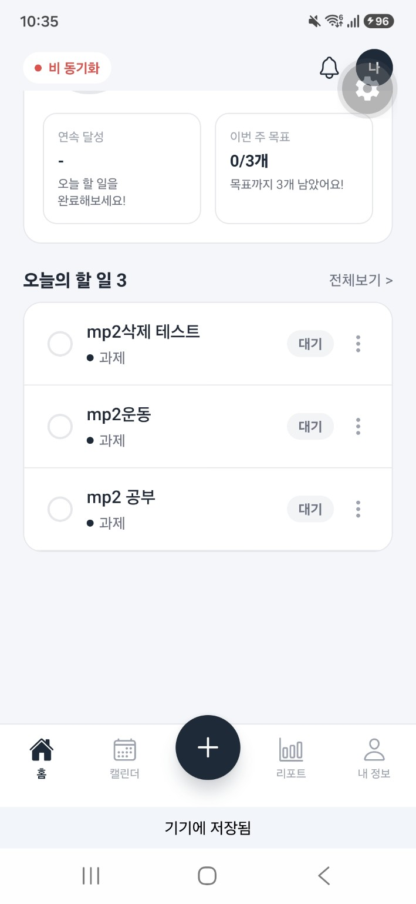
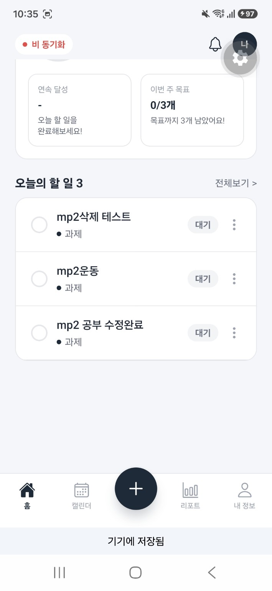
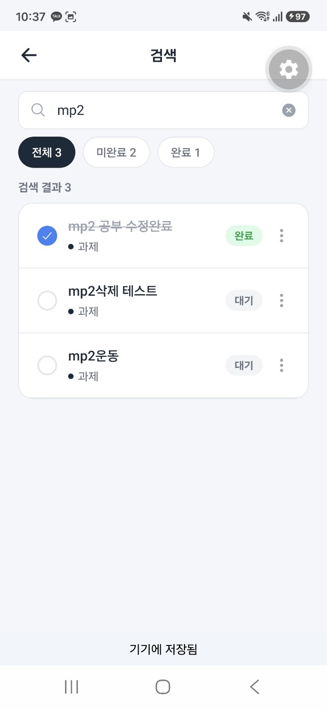
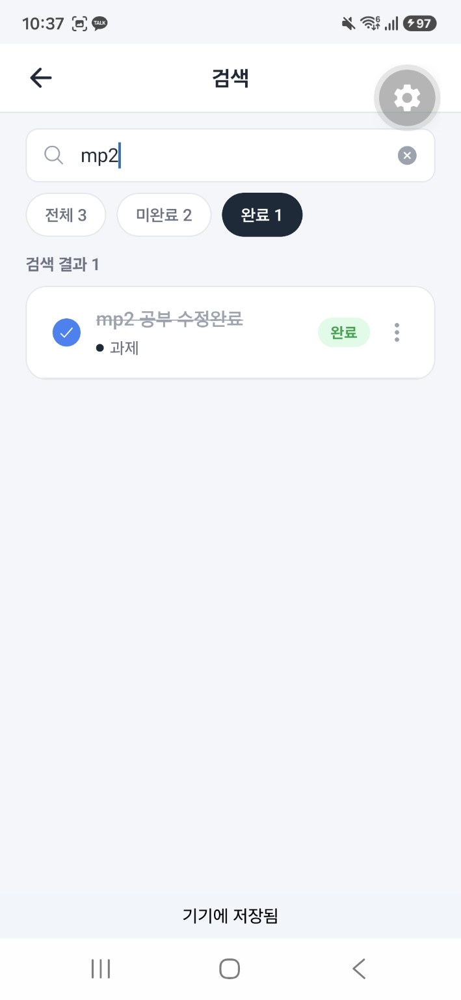
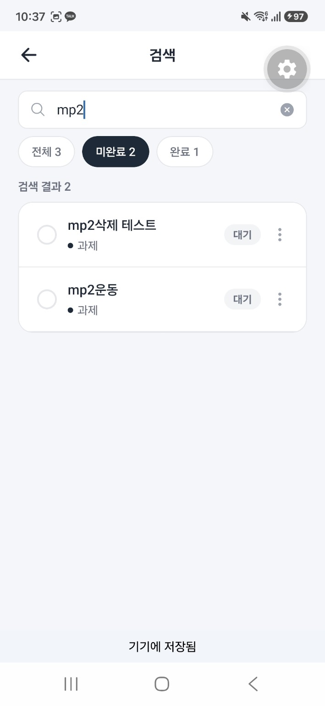
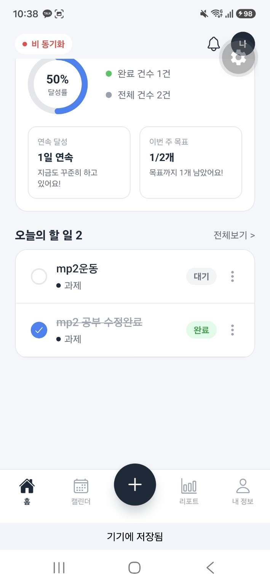
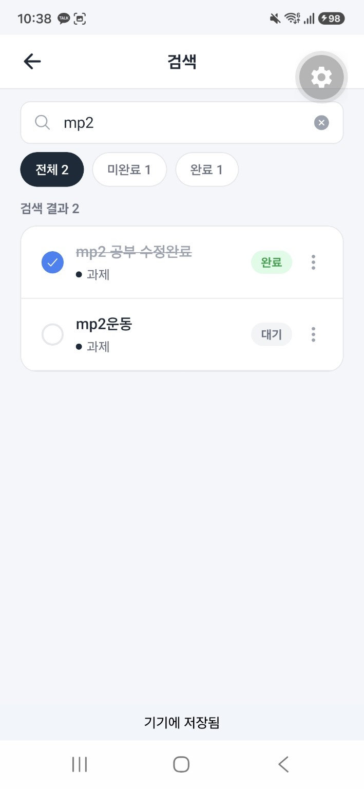
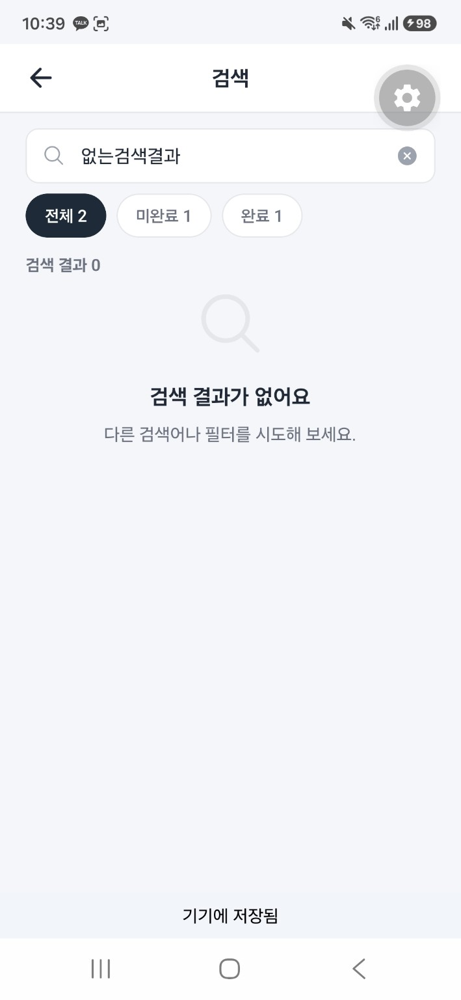

# 독도키 — MP2 로컬 저장 및 CRUD

React Native / Expo SDK 57 기반 할 일 앱. PR #5 반영 소스에서 로컬 저장을 추가한 수정본이다.

## 실행

Node.js 22.13 이상을 사용한다. 프로젝트 폴더에서:

```powershell
npm.cmd ci
npx.cmd expo start
```

동일 네트워크의 Expo Go로 QR 코드를 연다. 웹은 `npm.cmd run web`.
기기의 Expo Go가 SDK 57을 지원하는지 확인한다. 프로젝트 SDK를 임의로 내리지 않는다.

```powershell
npm.cmd test
npm.cmd run typecheck
```

## 구현 기능

- 할 일 추가·수정·삭제·완료 처리, 제목·메모 검색, 전체·완료·미완료 필터
- 날짜별 여러 일정 및 매주 반복, 묶음 수정·삭제, 개별 삭제 회차 유지
- 카테고리 추가·삭제 및 기존 할 일의 기타 이동
- 홈·캘린더·리포트·프로필 화면
- 할 일·카테고리·프로필 자동 저장과 앱 시작 시 복원
- 저장 중/완료 표시, 읽기·쓰기 오류 안내와 재시도
- 네이티브 프로필 사진은 캐시에서 앱 문서 폴더로 복사. 웹은 크기를 제한한 data URL 저장

알림 발송·실제 OCR은 미구현이다. OCR 화면은 예시이며 실제 인식 시간으로 표시하지 않는다.
- MP3 Supabase 공유 목록, 새로고침 조회, 오프라인 변경 대기열 및 재연결 전송

## 저장 방식과 선택 이유

| 방식 | 장점 | 고려사항 | 선택 |
| --- | --- | --- | --- |
| AsyncStorage | Expo Go 및 웹 지원, JSON 상태 저장·복원이 간단함 | 대량 데이터 검색·부분 갱신에는 불리함 | 현재 MP2의 소규모 목록에 사용 |
| SQLite | 많은 데이터, 쿼리·트랜잭션·인덱스에 적합 | 테이블·마이그레이션과 플랫폼별 설정이 추가됨 | 데이터 규모가 커지면 검토 |
| SecureStore | 민감한 작은 값의 보관에 적합 | 할 일 목록·사진 같은 큰 데이터에 부적합 | 목록 저장에 사용하지 않음 |

키 `dokdoki.todos.v1`에 `{version: 1, todos, categories}`를 함께 저장한다. 카테고리 삭제와 할 일 이동이 하나의 스냅샷에 포함된다.
프로필은 `dokdoki.profile.v1`에 별도로 저장한다. 저장된 값은 서버로 전송되지 않는다.

앱 시작 시 읽기·검증을 마치기 전에는 편집 화면을 열지 않는다. 읽기나 JSON 검증에 실패하면 기존 저장값을 덮어쓰지 않고 재시도를 제공한다.
쓰기 요청을 순서대로 처리하여 느린 이전 저장이 최신 편집을 덮어쓰지 않도록 한다. 실패한 최신 상태는 메모리에 유지하고 사용자가 재시도할 수 있다.
앱을 종료하기 전 하단의 **기기에 저장됨**을 확인한다. OS가 저장 완료 전에 프로세스를 강제 종료하면 마지막 변경은 보장되지 않는다.

브라우저는 동일 origin의 로컬 저장소를 사용한다. 주소/포트를 바꾸거나 사이트 데이터를 삭제하면 다른 저장소로 보일 수 있다.
앱 삭제·앱 데이터 초기화 시 저장값도 삭제된다. 기기 간 동기화는 MP3 범위다.

## 상태·통계 기준

- 완료: 사용자가 완료 체크함. 체크 시 실제 완료 시각을 기록한다.
- 진행: 완료하지 않았으며 지정한 날짜·시간이 도래함.
- 대기: 예정 시간이 아직 오지 않았거나 날짜·시간 미지정.
- 오늘/월별 개수/통계 날짜는 기기의 로컬 날짜를 사용한다. 약 30초마다 및 앱 활성화 시 갱신한다.
- 달성률과 요일별 현황은 **예정 날짜** 기준이다. 주간·월간 탭은 기간 시작부터 오늘까지 집계한다.
- 연속 달성은 실제 완료일을 사용한다. 완료일이 없는 구형 항목은 예정 날짜로 보완한다.
- 개별 삭제한 주간 회차는 날짜·시간 예외 목록으로 남아 이후 묶음 수정에서도 제외된다.

## 코드 구조

- `hooks/useTodos.ts`: 할 일·카테고리 변경, 상태 판단
- `utils/persistentStore.ts`: 복원·순차 저장·재시도, 저장소 어댑터 경계
- `hooks/usePersistentState.ts`: AsyncStorage와 React 연결
- `utils/storageSchema.ts`: 저장 데이터 버전·구조 검사
- `components/StorageGate.tsx`: 복원 대기, 저장 상태 및 오류 안내
- `navigation/ProfileContext.tsx`: 프로필 공유와 저장
- `utils/schedule.ts`: 반복 생성·수정·개별 삭제
- `tests/persistence.test.cjs`: 복원·저장 순서·실패 복구·반복 삭제 회귀 테스트

## MP3 — Supabase 공유 목록 동기화

### 선택한 BaaS와 이유

Supabase를 사용한다. PostgreSQL 테이블과 SQL 정책을 과제 제출물로 명확히 보여줄 수 있고, Expo 앱에서 클라이언트 SDK로 저장·조회를 연결할 수 있다. 앱에는 로그인 화면을 추가하지 않는다. 두 에뮬레이터는 Supabase의 같은 `dokdoki-shared` 공유 목록을 사용한다.

### 백엔드 설정

1. 프로젝트 루트에서 `.env.example`을 복사해 `.env`를 만든다.
2. `.env`에 Supabase Project URL과 Publishable key를 입력한다. `service_role` 또는 `sb_secret` 키는 앱에 넣지 않는다.
3. Supabase Dashboard의 SQL Editor에서 `supabase/schema.sql`을 한 번 실행한다.
4. 앱을 다시 시작한다: `npx expo start -c`.

SQL은 `shared_todo_state` 테이블과 익명 클라이언트용 RLS 정책을 만든다. 이 과제용 테이블은 로그인 없이 공유되는 공개 시연 목록이다. 민감한 실제 일정이나 개인정보를 넣지 않는다. 클라이언트 Publishable key는 비밀이 아니며, 이 데모의 데이터 접근 제한은 단일 행 ID를 확인하는 RLS 정책으로 제한된다.

### 동기화 및 오프라인 처리

- 할 일·카테고리 변경은 기존 AsyncStorage에 먼저 반영하고, 최신 전체 상태를 별도의 로컬 동기화 대기열에 보관한다.
- 연결이 없으면 로컬 변경을 유지하고 상태를 오프라인으로 표시한다. 네트워크 복구, 앱 재활성화 또는 홈 화면을 아래로 당겨 새로고침하면 대기 상태를 서버에 전송한다.
- 홈 화면을 아래로 당겨 서버의 공유 목록을 다시 조회한다. 두 번째 기기에서는 이 동작으로 첫 번째 기기의 변경을 확인한다.
- Supabase 테이블에 데이터가 아직 없을 때는 기존 기기 로컬 데이터를 최초 공유 상태로 올린다. 서버 데이터가 이미 있으면 서버 상태를 내려받는다. 전송에 실패하면 로컬 대기열을 지우지 않고 다음 연결 시 재시도한다.

### 충돌 처리 방침

서버에는 할 일과 카테고리 전체를 하나의 JSON 스냅샷으로 저장한다. 오프라인에서 양쪽 기기가 서로 다른 상태를 편집한 경우, **마지막으로 Supabase에 성공적으로 기록된 스냅샷이 목록 전체를 대체**한다. 필드별 병합은 하지 않는다. 따라서 동시 편집 시 앞선 스냅샷의 변경이 사라질 수 있다. MP3 과제 시연에서는 한 기기의 변경을 동기화한 뒤 다른 기기에서 새로고침하는 순서로 확인한다.

### 실행 및 검증 시나리오

```sh
npm ci
npx expo start -c
```

1. 기기 A에서 할 일을 추가하고 서버 동기화 완료 표시를 확인한다.
2. 기기 B의 홈 화면을 아래로 당겨 새로고침하고 같은 항목이 나타나는지 확인한다.
3. 기기 A에서 네트워크를 끄고 항목을 추가한다. 오프라인 표시와 로컬 저장을 확인한 뒤 네트워크를 켠다.
4. 서버 동기화 완료 후 기기 B를 새로고침하고, Supabase Table Editor의 `shared_todo_state` 행에도 반영됐는지 확인한다.

제출용 캡처는 `screenshots/mp3/`에 기기 A 추가, 기기 B 새로고침 후 동기화, 오프라인 작성 후 온라인 반영, Supabase 콘솔 화면을 각각 저장한다. 자동 테스트 결과와 실제 에뮬레이터 검증 결과는 구분해서 기록한다.

## 검증 결과

자동 테스트와 실제 기기 검증을 구분하여 기록한다.

| 검증 | 결과 | 근거 |
| --- | --- | --- |
| 자동 테스트 | 38개 통과, 실패 0개 (2026-11-04 재검증) | `npm.cmd test`; 저장소 및 일부 네이티브 API는 테스트 어댑터 사용 |
| TypeScript | 통과 (2026-11-04 재검증) | `npm.cmd run typecheck` |
| Android / Expo Go CRUD·필터 | 사용자 실행 및 캡처로 확인 (2026-11-04) | 아래 캡처 01~06 |
| 완전 종료 후 복원 | 사용자 재실행 확인 및 캡처 검토 (2026-11-04) | 06과 07의 제목·완료·삭제 상태 비교 |
| 빈 검색 결과 | 안내 문구 표시 확인 | 캡처 08 |

테스트 항목 3개를 등록하고 `mp2 공부`를 `mp2 공부 수정완료`로 수정하여 완료 처리했다.
전체 3개·완료 1개·미완료 2개 필터를 확인한 뒤 `mp2삭제 테스트`를 삭제했다.
저장 완료 표시 후 Expo Go를 최근 앱 목록에서 완전히 종료하고 동일 프로젝트를 다시 실행했다.
사용자가 재시작 후 촬영했음을 확인했으며, 캡처에는 수정된 제목·완료 상태와 남은 2개 항목이 유지된다.
이는 해당 Android 기기와 시나리오의 검증이며 모든 기기·오류 상황의 통과를 의미하지 않는다.

PR 소스·설정·테스트 파일은 사용자가 실행 중인 폴더와 바이트 비교하여 동일함을 확인한 뒤 줄 끝 공백만 정리하고, 해당 폴더의 설치된 의존성으로 재검증했다. 별도 clone에서 `npm ci`는 Windows EPERM으로 완료되지 않아 깨끗한 설치와 전체 웹 빌드는 이번에 검증하지 못했다.

### 실행 화면

| 수정 전 | 수정 후 |
| --- | --- |
|  |  |

| 전체 필터 | 완료 필터 | 미완료 필터 |
| --- | --- | --- |
|  |  |  |

| 삭제 후·재시작 전 | 재시작 후 | 빈 검색 결과 |
| --- | --- | --- |
|  |  |  |

상단 ‘비 동기화’는 서버 동기화 상태이며, 하단 ‘기기에 저장됨’은 로컬 저장 상태이다.
서버 동기화는 MP3 범위이며 로컬 저장과 구분한다. 원본 캡처의 시스템 오버레이는 편집하지 않았다.

## MP2 평가 기준과 구현 위치

| 기준 | 구현 및 증거 |
| --- | --- |
| 항목 수정·삭제 | `hooks/useTodos.ts`, `screens/TodoFormScreen.tsx`, `components/TodoListItem.tsx`; 캡처 01·02·06 |
| 전체·완료·미완료 필터 | `screens/SearchScreen.tsx`; 캡처 03~05 |
| 재시작 후 데이터 유지 | `hooks/usePersistentState.ts`, `utils/persistentStore.ts`, `utils/storageSchema.ts`; 캡처 06·07 |
| 저장 방식 선택 이유 및 대안 비교 | 위 ‘저장 방식과 선택 이유’ 절 |
| AI 활용 기록 | [prompts_log.md](prompts_log.md) |

MP3 평가 기준: 기기 간 동기화는 `hooks/useTodos.ts`와 `screens/HomeScreen.tsx`, 오프라인 대기열은 `utils/sharedSync.ts`, Supabase 스키마 및 공개 데모 정책은 `supabase/schema.sql`, 설정 키 예시는 `.env.example`에 있다. 실제 두 기기 동기화와 Supabase 콘솔 캡처는 실행 환경에서 확인한 뒤 `screenshots/mp3/`에 추가한다.

MP1 및 PR #5의 기존 화면·일정 관리 기능 위에 MP2 저장 기능을 추가했다.
기존 팀 작업을 모두 이번 MP2에서 새로 구현한 것으로 표기하지 않는다.

## 검증 범위와 제한

- 자동 테스트의 저장소 어댑터 검증과 실제 Android 재시작 검증은 별개이다.
- iOS 실기기, 프로필 사진의 실기기 재시작 유지, 장시간·대량 데이터 동작은 이번 캡처로 검증하지 않았다.
- 잘못된 저장 데이터와 쓰기 실패·재시도는 자동 테스트로 확인했다. 실제 기기의 저장 공간 부족을 강제로 재현하지 않았다.
- 앱 삭제·앱 데이터 초기화 시 로컬 데이터는 제거된다. 서버 백업은 없다.
- 프로필 사진을 변경하면 영구 보관 사본을 생성한다. 과거 사본 자동 정리는 후속 개선 사항이다.
- OCR은 예시 데이터 데모이며 실제 인식·오프라인 OCR 검증을 완료한 것이 아니다.

자세한 재현 절차는 [MP2_CHECKLIST.md](MP2_CHECKLIST.md)를 참고한다.

## 과제 제출 구성

GitHub 저장소에서는 루트에 앱 소스를 유지한다. 과제 제출 ZIP을 만들 때는 앱 소스 전체를 `app/`에 넣고,
`README.md`, `screenshots/`, `prompts_log.md`를 ZIP 최상위에 배치한다.
이 README의 실행 명령은 저장소 루트 기준이며, 제출 ZIP에서는 먼저 `cd app`을 실행한다.
`node_modules`, `.expo`, `.git`, npm 캐시, 빌드 결과물, 실제 `.env` 파일은 제출하지 않는다.
AI-ANT의 실습노트는 실제 작업 시간과 경험을 바탕으로 별도로 작성한다.
